# 온길 기능 설명서

온길에 들어 있는 기능을 사용 흐름 순서대로 정리한 문서다. 화면은 모두 Pleos Connect 에뮬레이터 v2.1.0에서 찍었다. 실차가 없어 위치는 좌표를 재생했고, 지난 여행 기록과 지자체 스탬프 세트·공개 코스는 시연용 샘플 데이터다.

- [한눈에 보기](#한눈에-보기)
- [1. 지도 홈](#1-지도-홈)
- [2. 지역 고르기](#2-지역-고르기)
- [3. 지역 카드 (볼 곳 둘러보기)](#3-지역-카드-볼-곳-둘러보기)
- [4. 볼 곳 고르기](#4-볼-곳-고르기)
- [5. 코스](#5-코스)
- [6. 출발 · 내비 안내](#6-출발--내비-안내)
- [7. 알림 (가까워질 때 · 섰을 때 · 기록됐을 때)](#7-알림-가까워질-때--섰을-때--기록됐을-때)
- [8. 운전 중 화면](#8-운전-중-화면)
- [9. 도착 · 방문 기록 · 이야기](#9-도착--방문-기록--이야기)
- [10. 하루 끝 · 이어서 가기](#10-하루-끝--이어서-가기)
- [11. 내 지도](#11-내-지도)
- [12. 여행 기록](#12-여행-기록)
- [13. 스탬프](#13-스탬프)
- [14. 공개 코스](#14-공개-코스)
- [15. 내비 옆에 좁게 띄웠을 때](#15-내비-옆에-좁게-띄웠을-때)
- [방문은 이렇게 기록된다](#방문은-이렇게-기록된다)
- [하지 않는 것](#하지-않는-것)
- [1차 접수본의 범위](#1차-접수본의-범위)

---

## 한눈에 보기

| 단계 | 운전자가 하는 일 | 온길이 하는 일 |
|---|---|---|
| 고르기 (정차) | 지역을 고르고 갈 곳을 체크 | 지자체 세트·코스로 좁혀 보여 주고, 고른 곳을 가까운 순으로 정렬 |
| 출발 (정차) | "이 코스로 출발" | 고른 곳을 Pleos 내비 경유지로 넣음 (3곳씩 이어 붙임) |
| 이동 (주행) | 운전만 | 명소 1km 전에 내비 위 알림 카드 + 음성 1번 |
| 도착 (정차) | 기어 P | 그곳 이야기 30초, 3분 뒤 방문 기록 → 지도 색칠 → 스탬프 진행 |
| 하루 끝 | "오늘은 여기까지" | 못 간 곳을 남겨 두고 다음에 "남은 N곳 이어가기" |
| 나중에 (정차) | 내 지도·스탬프·공개 코스 보기 | 다녀온 지역·명소·여행 목록, 받은 스탬프, 코스 올리기 |

---

## 1. 지도 홈

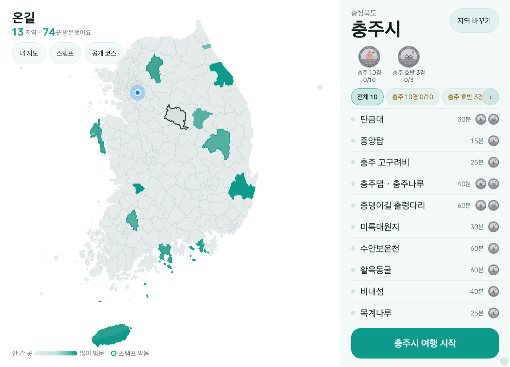

앱을 열면 나오는 첫 화면. 왼쪽은 우리나라 지도, 오른쪽은 고른 지역의 카드다.

- **방문 지도**: 방문을 기록한 시·군·구가 칠해진다. 방문한 명소가 많을수록 색이 진하다. 지나가기만 한 지역은 칠하지 않는다.
- **스탬프 받은 지역**: 지자체 스탬프를 받은 지역은 테두리가 한 줄 더 그려진다.
- **합계**: 지도 위에 "13 지역 · 74곳 방문했어요"처럼 다녀온 지역 수와 명소 수.
- **지도에서 지역 누르기**: 지역을 누르면 그 지역이 확대되고 오른쪽에 지역 카드가 열린다.
- **위쪽 버튼**: 내 지도, 스탬프, 공개 코스로 간다. 지역을 아직 안 골랐으면 "지역 고르기"도 보인다.
- **진행 중인 여행이 있으면**: 맨 아래 버튼이 "여행 이어가기 / 내비로 가기"로 바뀐다.
- **하루를 마쳤으면**: "남은 N곳 이어가기 / 남은 곳 보기 / 새로 고르기" (10절).
- **화면 테마**: 차의 밝음·어두움 설정을 따른다.

## 2. 지역 고르기

지도에서 작은 지역을 누르기 어려울 때 쓰는 목록. 왼쪽 열은 시·도, 오른쪽 열은 시·군·구다.

- 시·도를 누르면 지도가 그 시·도 전체로 이동하고 테두리가 강조된다.
- 시·군·구 오른쪽 숫자는 "방문한 곳 / 볼 곳" (예: 5 / 6). 한 번도 안 갔으면 "미방문", 아직 데이터가 없으면 "준비 중".
- 지역을 고른 뒤에는 카드 위쪽 "지역 바꾸기"로 다시 연다.

## 3. 지역 카드 (볼 곳 둘러보기)

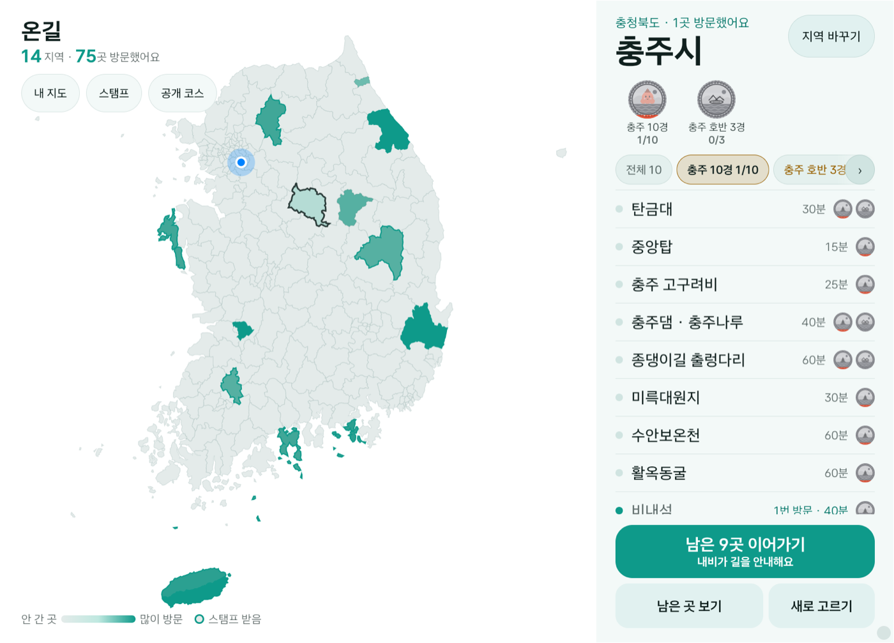 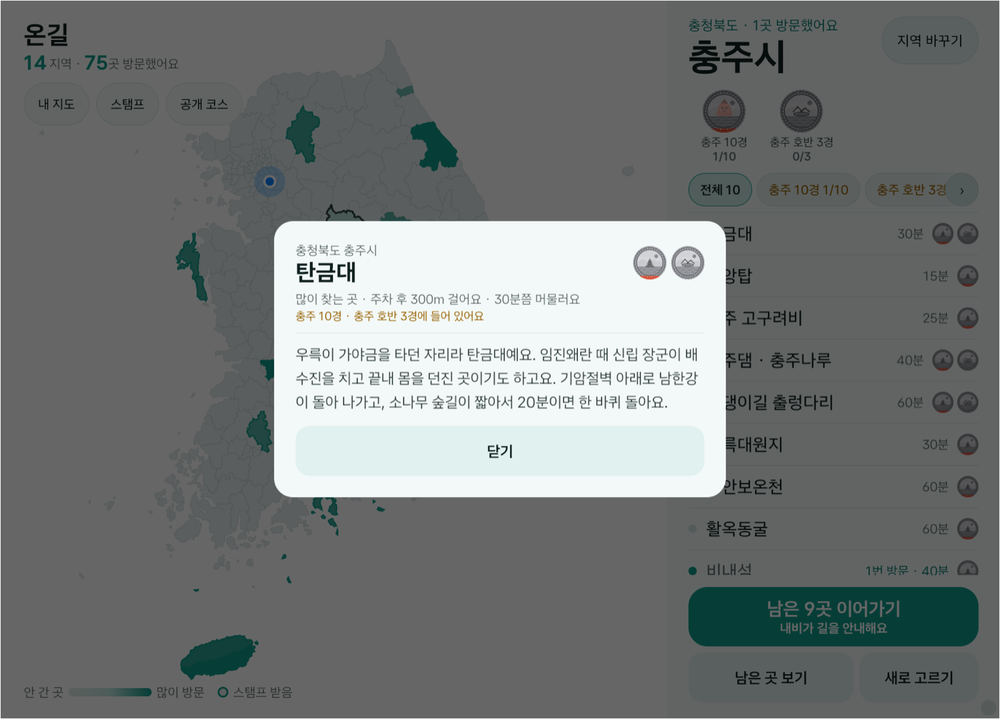

고른 지역의 볼 곳과 스탬프를 보여 준다.

- **머리줄**: 지역 이름과 "충청북도 · 3곳 방문했어요" 같은 진행.
- **스탬프 줄**: 이 지역 지자체가 발행한 스탬프가 한 줄로 놓인다. 스탬프 아래에 세트 이름과 진행(n/N). 진행 중인 스탬프는 방문한 비율만큼 아래부터 색이 차오른다. 5개가 넘으면 4개와 "+N"이 보이고, 누르면 전체 목록이 열린다. 스탬프를 누르면 큰 스탬프와 명소별 방문 여부가 나온다.
- **필터 칩**: 전체 / 각 지자체 세트("충주 10경", "충주 호반 3경") / 가볼만한 곳(세트에 없는 곳) / 코스(다른 사람·지자체가 다녀온 코스). 칩이 많으면 한 줄로 밀어서 본다(‹ › 버튼).
- **명소 줄**: 이름, 오른쪽에 머무는 시간("40분") 또는 방문 수("2번 방문"). 맨 오른쪽 작은 스탬프는 그 명소가 든 세트이고, 누르면 그 세트의 스탬프가 열린다.
- **명소 설명**: 줄을 누르면 "많이 찾는 곳 / 덜 알려진 곳", 주차 후 걷는 거리, 머무는 시간, 방문 수, 든 세트, 한국관광공사 소개글이 나온다.
- **코스 칩을 고르면**: 그 코스가 다녀온 순서대로 명소가 나오고, 갈 곳만 체크해 "고른 N곳으로 코스 짜기". 칩 끝 "＋ 코스 더"는 공개 코스로 간다.
- **맨 아래 버튼**: "{지역} 여행 시작" → 볼 곳 고르기. 데이터가 아직 없는 지역은 "곧 열리는 지역이에요".
- **세트가 없는 지역**: "지자체 스탬프는 아직 없어요"라고 보이고, 방문 기록과 지도만 남는다.

## 4. 볼 곳 고르기

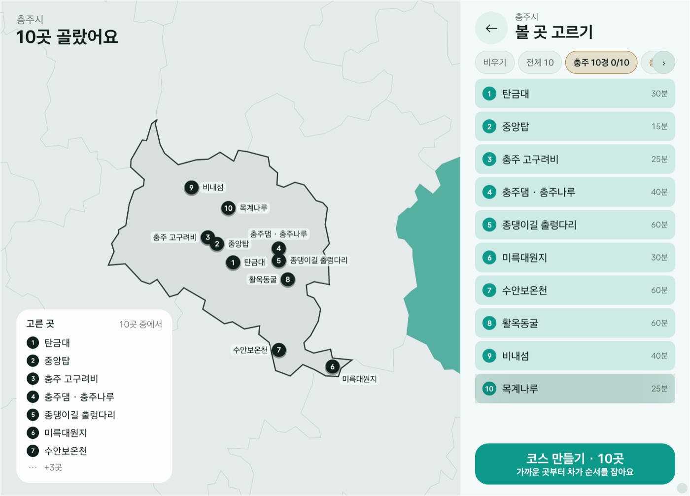

여행에서 앱이 묻는 것은 이것 하나다. 출발 시각·동행·숙소 같은 입력은 받지 않는다.

- **체크 목록**: 갈 곳을 하나씩 누른다. 오른쪽에 머무는 시간, 가 본 곳은 "n번 방문 · N분".
- **필터 칩**: 지역 카드와 같다(전체 / 세트 / 가볼만한 곳 / 코스). 고른 게 있으면 맨 앞에 "비우기".
- **고른 곳은 사라지지 않는다**: 필터를 바꿔도 지도에는 고른 곳 번호가, 왼쪽 아래 "고른 곳" 쪽지에는 목록(7줄 + "+N곳")이 남는다. 쪽지 위에 "10곳 중 n곳은 가 봤어요".
- **맨 아래 버튼**: "코스 만들기 · N곳".

## 5. 코스

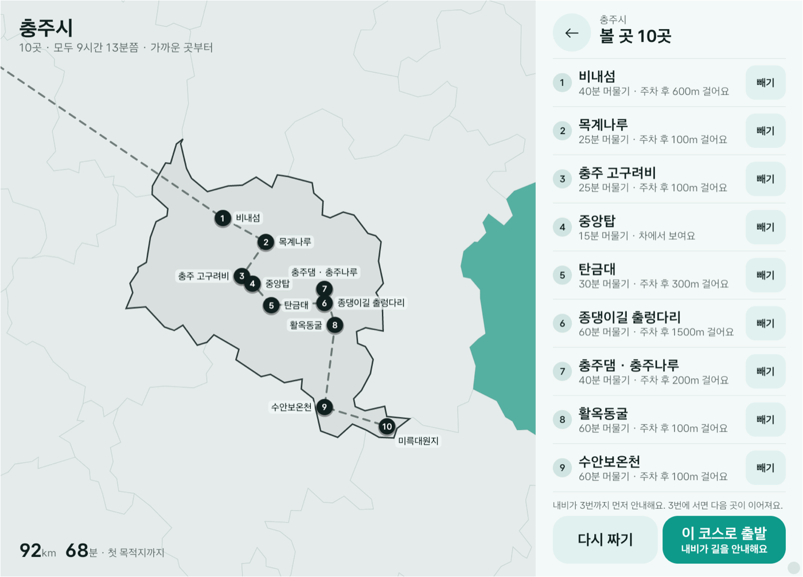

- **순서**: 지금 위치에서 가까운 곳부터 차례로 다음 가까운 곳을 잇는다. 시간 제한이나 날짜 나누기는 없다. 다 못 가면 남은 곳은 다음에 이어 간다.
- **줄마다**: 번호, 이름, "40분 머물기 · 주차 후 600m 걸어요".
- **무대**: 지역 이름, "10곳 · 가까운 곳부터", 전체 걸리는 시간("모두 9시간 13분쯤"), 지도에 번호와 경로.
- **첫 목적지까지 거리·시간**: Pleos 내비에서 받아 보여 준다(예: 92km · 68분).
- **안내**: 내비 경유지는 한 번에 3곳씩 들어간다. "3번에 서면 다음 곳이 이어져요".
- **버튼**: "다시 짜기"(고른 곳을 그대로 두고 볼 곳 고르기로) / "이 코스로 출발".

## 6. 출발 · 내비 안내

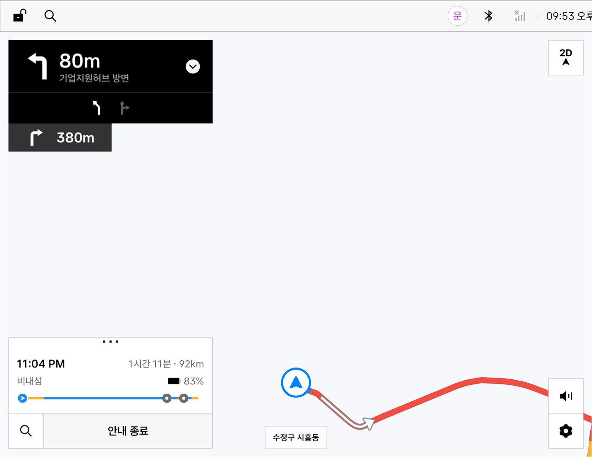

- "이 코스로 출발"을 누르면 앞 3곳(경유지 2곳 + 목적지)이 Pleos 내비에 들어가고 내비 화면이 앞으로 나온다.
- Pleos 내비는 경유지를 2개까지 받는다. 그래서 3곳씩 끊어 넣고, 그 구간의 마지막 곳에서 방문이 기록되면 다음 3곳을 자동으로 넣는다. 운전자는 다시 입력할 일이 없다.
- 온길은 뒤에서 위치만 확인한다(포그라운드 서비스, "온길 여행 중" 알림이 조용히 상주).

## 7. 알림 (가까워질 때 · 섰을 때 · 기록됐을 때)

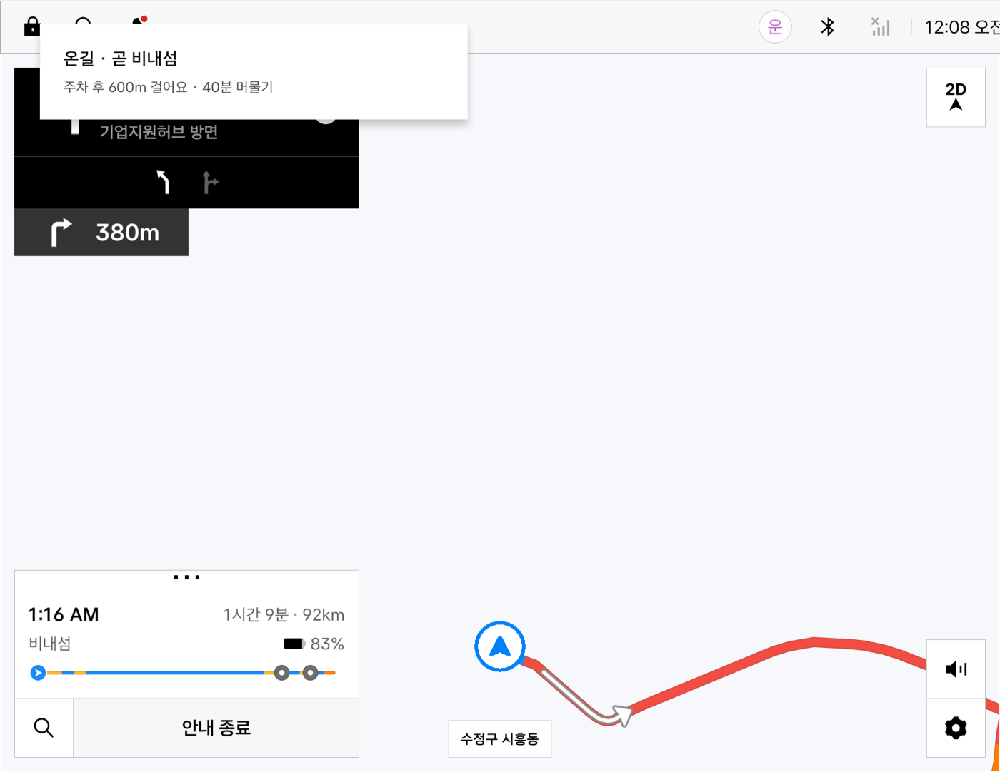 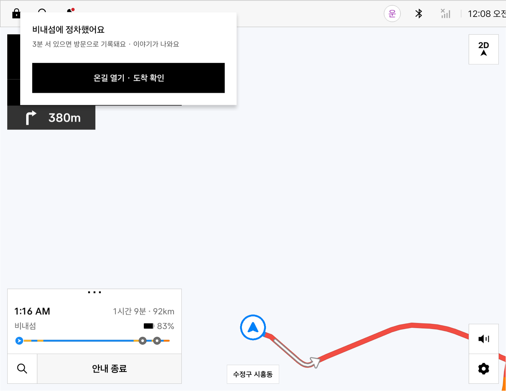

알림은 내비 위에 카드로 뜨고 20초 뒤 사라진다. 명소 하나에 카드 3장, 음성 2번이 전부다.

| 언제 | 카드 | 음성 |
|---|---|---|
| 명소 1km 전 (주행 중) | "온길 · 곧 비내섬 · 주차 후 600m 걸어요 · 40분 머물기" | "곧 비내섬이에요. 주차 후 온길에서 도착을 확인할 수 있어요." |
| 명소 가까이에서 기어 P | "비내섬에 정차했어요 · 3분 서 있으면 방문으로 기록돼요" + "온길 열기 · 도착 확인" 버튼 | 그곳 이야기 30초 |
| 3분이 지나면 | 방문이 기록됐다는 카드 (세트 진행 n/N) | — |
| 세트의 마지막 명소 | "충주 10경 스탬프를 받았어요" (이때만 1장 더) | — |

## 8. 운전 중 화면

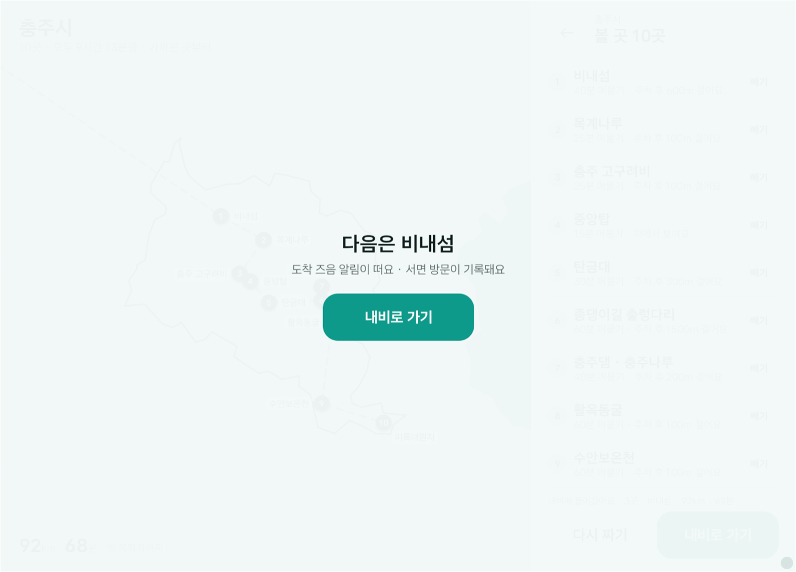

- 차가 "운전 중이라 화면 조작을 줄이라"는 신호(CarUxRestrictions)를 보내면, 온길은 목록과 입력을 모두 치우고 "다음은 ○○"와 큰 버튼만 남긴다.
- 버튼: "내비로 가기", 이야기를 들은 뒤면 "이야기 다시 듣기".
- 판단은 기어로 짐작하지 않고 차가 보내는 신호를 따른다. 신호가 풀리면 원래 화면으로 돌아온다.
- 운전 중에는 점수·순위·연속 기록 같은 것을 띄우지 않는다.

## 9. 도착 · 방문 기록 · 이야기

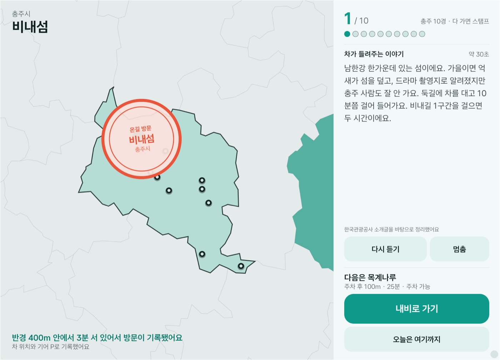

- **기다리는 동안**: 3분 정차를 기다리는 동안 링이 숨 쉬듯 움직이고 남은 시간이 보인다.
- **기록되는 순간**: 그 명소 점 위에 작은 스탬프가 찍히는 애니메이션(파문 + 먹물 방울). 머리줄에 "충주 10경 1/10 · 다 가면 스탬프", 아래에 "다음은 목계나루".
- **차가 들려주는 이야기**: 그곳 소개(약 30초)가 차 스피커로 나온다. 화면에 본문과 출처(한국관광공사 소개글 바탕), "다시 듣기 / 멈춤".
- **맨 아래 버튼**: "내비로 가기"(다음 명소로) / "오늘은 여기까지".
- 한 명소가 여러 세트에 들어 있으면 한 번 방문이 그 세트 모두에 오른다. 예: 탄금대·종댕이길·충주댐은 "충주 10경"과 "충주 호반 3경" 둘 다에 들어 있다.

## 10. 하루 끝 · 이어서 가기

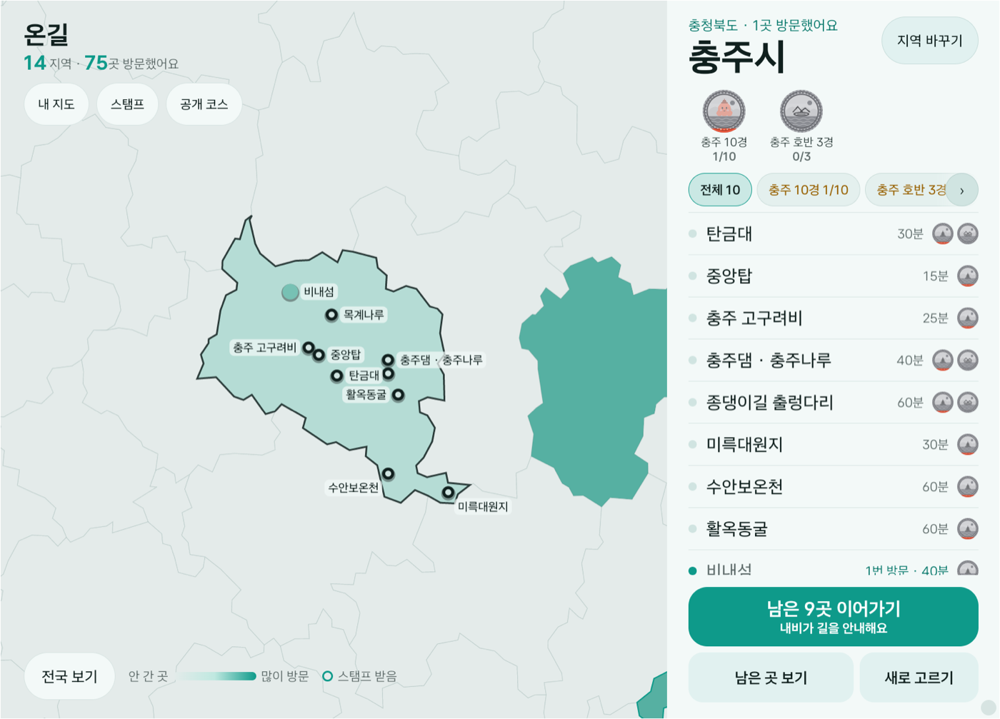 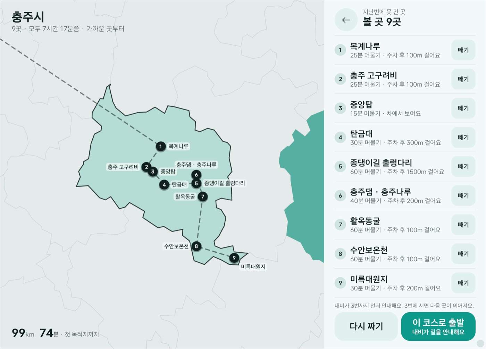

- "오늘은 여기까지"를 누르면 지도 홈으로 돌아온다. 오늘 간 지역이 칠해져 있다.
- 못 간 곳은 지워지지 않고 남는다. 지역 카드 맨 아래가 "남은 N곳 이어가기 / 남은 곳 보기 / 새로 고르기"로 바뀐다.
- **남은 N곳 이어가기**: 바로 내비에 다시 넣는다.
- **남은 곳 보기**: 멈춘 곳에서 가까운 순으로 다시 정렬한 코스. 빼거나 "다시 짜기"로 더 골라 출발.
- 이어 간 회차는 여행 기록에서 같은 여행으로 묶인다("2번 나눠 감").

## 11. 내 지도

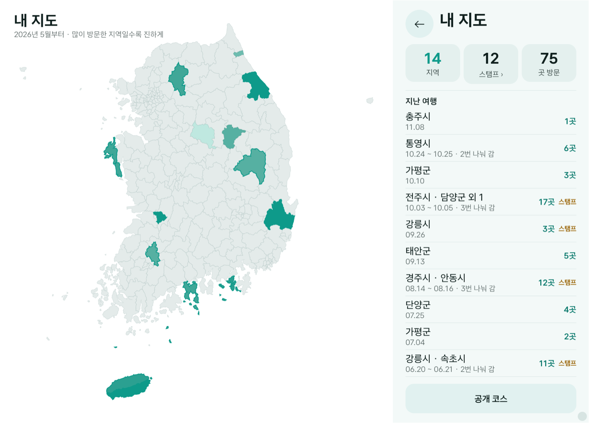

- **무대**: 전국 방문 지도와 "2026년 5월부터 · 많이 방문한 지역일수록 진하게".
- **큰 숫자 셋**: 지역 / 스탬프 › / 곳 방문. "스탬프"를 누르면 스탬프 화면으로.
- **지난 여행**: 여행 하나에 한 줄. 여러 지역을 돌았으면 "전주시 · 담양군", 나눠 갔으면 날짜 범위와 "2번 나눠 감", 방문한 곳 수, 스탬프를 받은 여행은 금색 "스탬프". 누르면 여행 기록(12절).
- **맨 아래**: "공개 코스".

## 12. 여행 기록

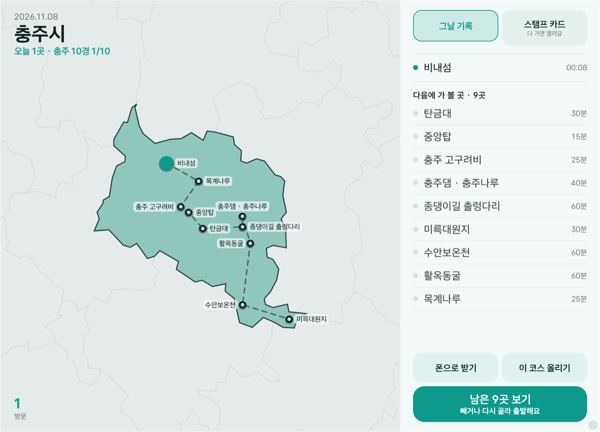

- **탭**: "그날 기록" / "스탬프 카드"(세트를 다 돌았을 때만 열림, 아니면 "다 가면 열려요").
- **그날 기록**: 방문한 곳마다 방문 시각과 머문 시간("14:05 · 4분 머묾"). 들르지 않고 지나친 곳은 "지나감".
- **다음에 가 볼 곳**: 그 지역에서 아직 안 간 곳(회색 점, 머무는 시간). 다 갔으면 나오지 않는다.
- **무대**: 날짜, 지역 이름(이어 간 회차면 "· 이어서"), "오늘 n곳 · 충주 10경 8/10", 거리·걸린 시간(5km·5분 넘을 때만), 방문 수.
- **이 코스 올리기**: 실제로 들른 곳과 순서로 코스를 만든다. 올린 뒤에는 "코스 올렸어요".
- **맨 아래**: 아직 남은 곳이 있는 여행이면 "남은 N곳 보기", 아니면 "내 지도로".

## 13. 스탬프

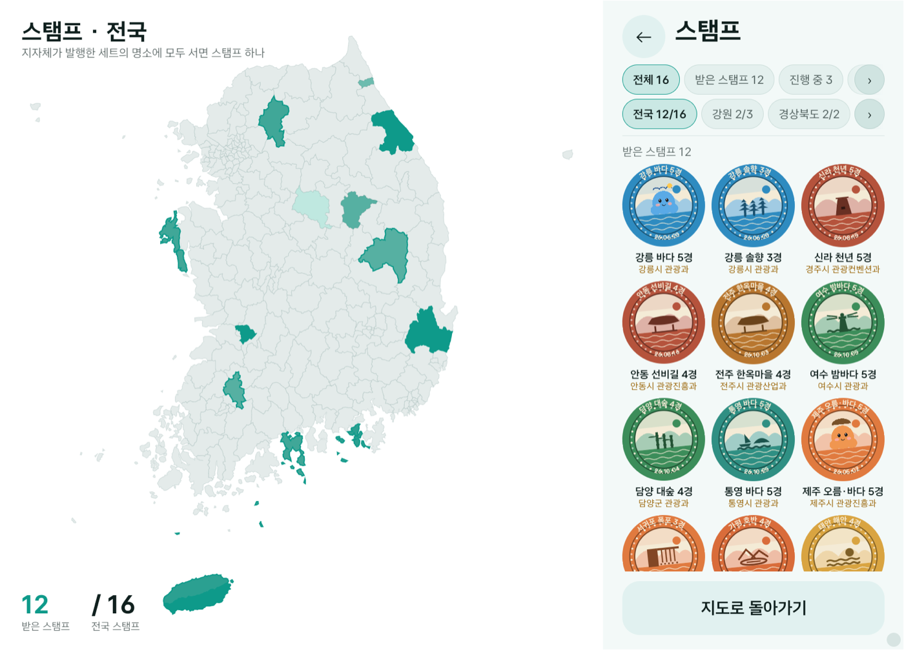 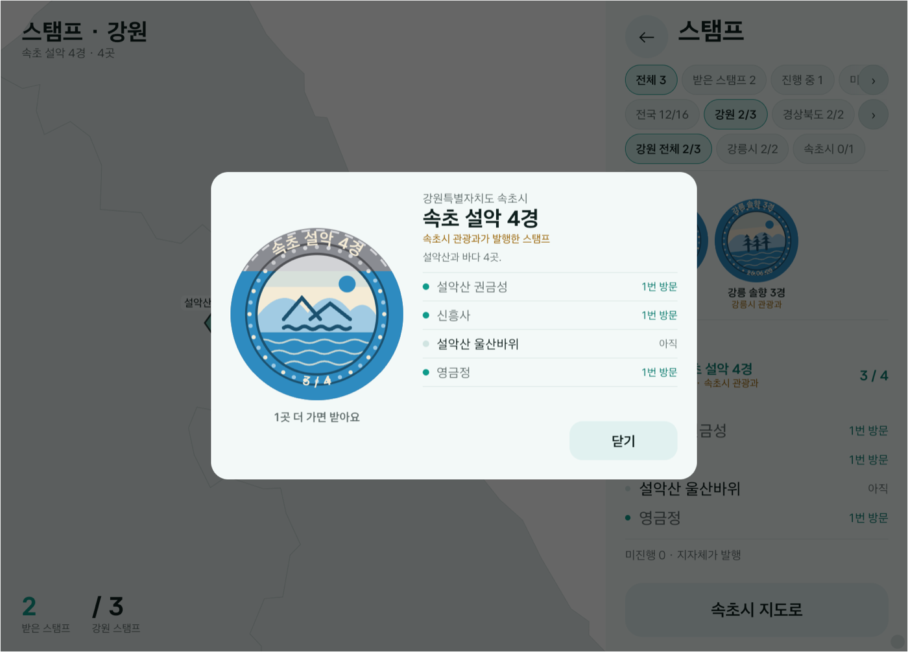

스탬프는 지자체가 발행한 명소 세트를 다 돌면 받는다. 한 지역에 세트가 여럿일 수 있다.

- **상태 칩**: 전체 N / 받은 스탬프 / 진행 중 / 미진행.
- **지역 칩**: 전국(받은 수/전체) → 시·도("강원 2/3") → 고르면 시·군·구("강릉시 2/2"). 무대 제목도 "스탬프 · 강원 · 강릉시"로 바뀐다.
- **세 구역**: 받은 스탬프(세트 이름·받은 날짜) / 진행 중(n/N, 방문한 만큼 아래부터 색이 차오름, 펼치면 명소별 방문 수와 지도의 점) / 미진행(아직 한 곳도 안 간 세트).
- **스탬프 모양**: 일본 맨홀 뚜껑처럼 둘레 띠에 세트 이름과 날짜(진행 중이면 진행도)를 두르고, 안쪽에 그 지역 풍경(탑·파도·산·한옥·등대·대나무 등 지역별 그림)이 들어간다. 색은 시·도마다 다르고, 못 받은 스탬프는 회색. 충주·강릉·제주는 지자체 마스코트 자리(지금은 임시 그림).
- **스탬프 자세히**: 누르면 큰 스탬프, 세트 설명, 발행처, 명소별 방문 여부.
- 시간·날씨·속도 같은 조건은 없다. 명소에 다 서기만 하면 된다.

## 14. 공개 코스

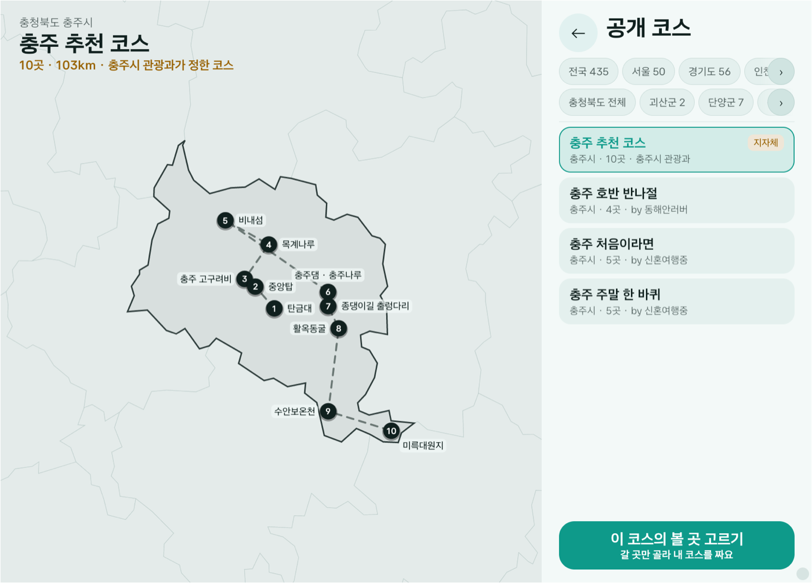

- **범위 칩**: 전국 → 시·도 → 시·군·구로 좁힌다. 칩마다 코스 수.
- **목록 순서**: 보고 있던 지역의 코스가 먼저, 그다음 많이 다녀간 순. 지자체 추천 코스는 금색으로 맨 위.
- **코스를 고르면**: 지도에 경로와 번호, 명소 목록.
- **이 코스의 볼 곳 고르기**: 그 코스의 명소가 체크된 채 볼 곳 고르기가 열린다. 갈 곳만 남기고 내 코스로 짠다.
- 1차 접수본에는 서버가 없어 목록은 샘플 데이터(435개, 지자체 추천 14개 포함)이고, "이 코스 올리기"로 만든 코스는 이 차 안에만 저장된다.

## 15. 내비 옆에 좁게 띄웠을 때

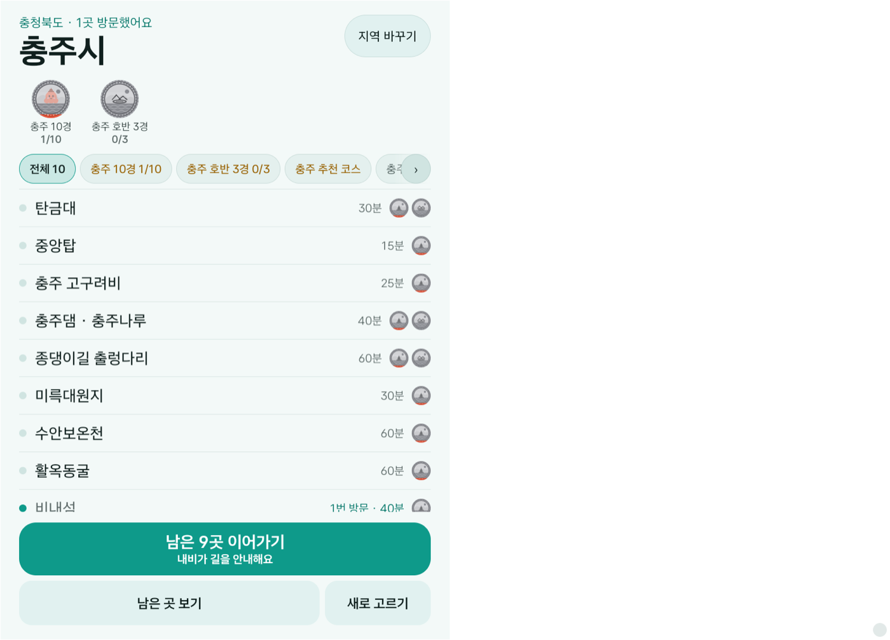

- 창 폭이 1100dp보다 좁아지면 지도를 접고 오른쪽 카드만 보여 준다. 도착 화면은 명소 이름을 위에 올린다.
- 에뮬레이터는 앱 창이 하나라 반 폭으로 흉내 내 확인했다. 실차 화면 분할에서는 아직 확인 전이다.

---

## 방문은 이렇게 기록된다

| 규칙 | 내용 |
|---|---|
| 언제 기록하나 | 온길을 켜고 여행(코스 출발)하는 동안에만. 평소에 뒤에서 위치를 모으지 않는다 |
| 어디서 | 명소 반경 안. 기본 300m, 명소마다 조절(주차장이 먼 비내섬은 400m) |
| 어떻게 | 반경 안에서 기어 P가 3분 이어지면 방문 |
| 기어를 떼면 | 3분을 처음부터 다시 센다 |
| GPS가 흔들리면 | 반경 경계 밖 120m까지는 흔들림으로 보고 상태를 유지 |
| 지나쳤다가 돌아오면 | 다시 반경에 들어와 서면 기록된다 |
| 남는 것 | 명소, 시각, 정차 시간, 위치, 차량 식별값(SHA-256 해시), 시뮬레이션 여부 |
| 같은 곳을 또 가면 | 다른 여행이면 방문이 또 쌓인다(지도에서 점이 진해짐). 세트 진행은 명소 단위로 한 번만 센다 |
| 앱이 꺼졌다 켜지면 | 진행 중인 여행이 그대로 복원된다 |

## 하지 않는 것

- 추천·AI 코스 생성. 볼 곳은 사람이 고르고, 앱은 순서만 잡는다.
- 손으로 지도 칠하기. 방문은 차가 선 것만 센다.
- 운전 중 목록·입력, 점수·순위·연속 기록, 속도·시간 조건.
- 평소 위치 수집, 계정·서버(1차 접수본).

## 1차 접수본의 범위

| 있음 | 아직 없음 (이후) |
|---|---|
| 115개 시·군·구 명소(717곳, 한국관광공사 TourAPI). 나머지 115개는 "준비 중" | 나머지 시·군·구 |
| 위 1~15절 전부 | 코스를 다른 차와 주고받기, "이 코스로 다녀온 차 N대" |
| 지자체 스탬프 세트 16개(14개 지역)·공개 코스 435개 — 샘플 | 실제 지자체 세트 등록·검수 도구 |
| 차 안 저장(서버 없음) | 내 지도·스탬프를 이미지로 폰에 받아 자랑하기 |
| | 계정 연결(차 교체·렌터카), 방문 기록 위조 검증, 음성 명령 |

샘플 데이터의 지자체 부서명은 가상이고 실제 지자체와 협의한 것이 아니다.
