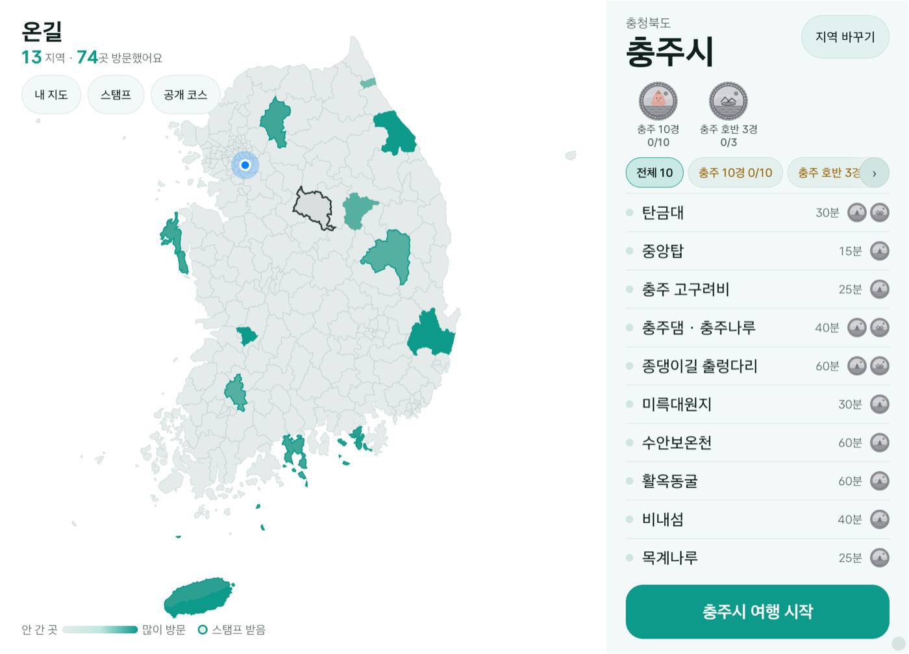
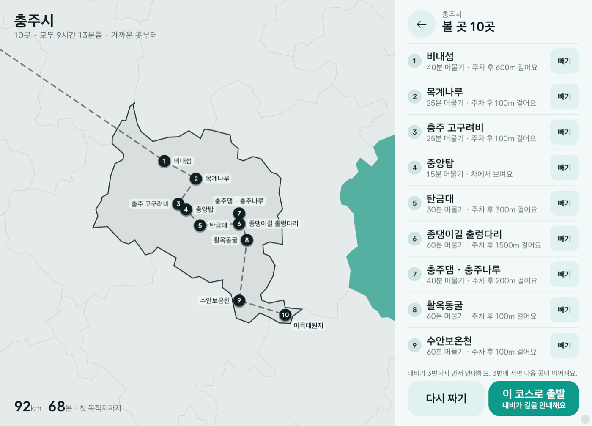
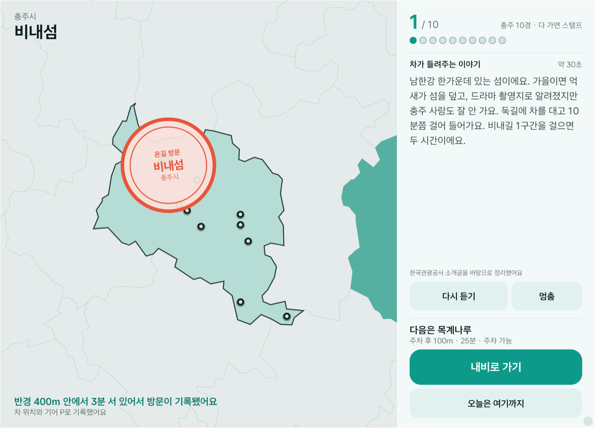
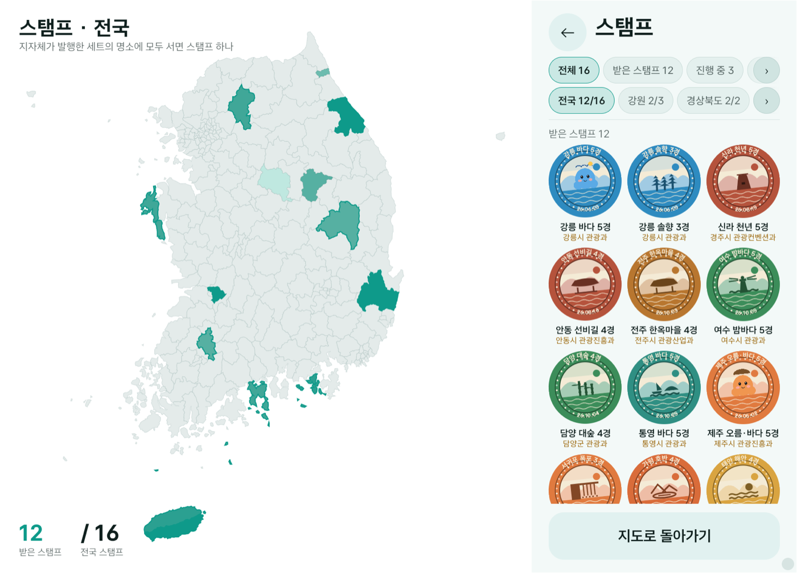

# 온길 (OnGil) — 차로 우리나라 지도를 채우는 앱

현대차그룹 차량용 앱 개발 공모전(Pleos App Market) 출품작. Pleos Connect(AAOS) 앱, 개인 참가.

명소에 차가 **실제로 서면**(반경 300m 안 기어 P 정차 3분) 방문이 기록되고, 그 시군구가 방문한 명소 수만큼 진해진다(히트맵). 지나가기만 한 땅은 세지 않는다. 지자체가 걸어 둔 세트("충주 10경")의 명소에 모두 서면 **스탬프** 하나를 받아 스탬프 화면에 모인다. 여행 기록과 내 지도는 나중에 내 지도에서 QR로 폰에 가져간다. 다른 차가 다녀온 코스·지자체 추천 코스에서 갈 곳만 골라 내비에 꽂는다. 볼 곳은 추천 없이 사용자가 직접 고른다. 언제·누구와·어디서 자는지는 묻지 않는다. 고른 곳은 가까운 순으로 내비에 들어가고, 그날 못 간 곳은 다음에 "이어가기"로 남는다.

| 지도 홈 (히트맵) | 코스 → 이 코스로 출발 | 도착 · 방문 기록 | 스탬프 |
|---|---|---|---|
|  |  |  |  |

아키텍처(인터랙티브, 소스 링크 포함): [`docs/architecture/ongil-architecture.html`](../docs/architecture/ongil-architecture.html)

## 구조

```
core/   순수 Kotlin, Android 의존 없음. 모델(Spot·Plan·Stamp·StampSet·RegionVisit·Course), Planner(가까운 순 체크 목록·이어가기), VisitJudge(정차 판정), Stamps(세트 진행도), Heat(히트맵). JUnit 테스트 12개(정차 판정 6 · 히트맵 3 · 코스 2 · 음성 조사 1)
app/    Pleos Connect 앱 (Compose). 리액트식 단방향 흐름: Component → Page → Store → Repository → API
  ui/components/  Theme(디자인 시스템 토큰 v1 청록 · 시스템 밝음·어두움 · Stage·BigButton…)·Qr·ChipRow(한 줄 칩 + ‹ ›)·StampArt(맨홀 뚜껑식 스탬프, 마스코트 자리)·map/KoreaMap(230개 시군구 폴리곤을 Canvas에 직접, 외부 지도 SDK 없음)
  ui/pages/       화면 1개 = 파일 1개. Home·Input(볼 곳 고르기)·Recommend(코스)·Arrival·Card(지난 여행 기록)·MyMap·Stamps(스탬프)·Courses(공개 코스, 전국→시·도→시·군·구). Stage = 왼쪽 지도 + 오른쪽 레일 560dp(창 폭 1100dp 미만이면 지도 없이 레일만: 실차 2윈도우에서 내비 옆에 붙는 경우. 디버그 빌드는 `--ez narrow true`로 흉내)
  store/          AppStore(ViewModel): 화면 라우팅·입력·추천 상태. 페이지는 store만 본다
  repository/     CatalogRepository(assets 명소·폴리곤) · RecordRepository(내 기록 JSON 1개) · StampRepository(스탬프 세트) · CourseRepository(공개 코스)
  api/            OngilApi 인터페이스 + MockOngilApi(assets·메모리). 차 밖에 있어야 하는 것만: 스탬프 세트·공개 코스. 서버가 생기면 구현만 교체
  service/        TourService: 포그라운드. 근접 알림 → 정차 헤드업("온길 열기") → 정차 판정 → 방문 기록 → 스탬프 → 여행 기록
  gateway/        외부 SDK 추상화. 인터페이스(NavigationGateway·PositionSource·VehicleSource·Narrator·DrivingRestrictions)만 바깥에 노출
    pleos/        NaviHelper 3.0.5 · FusedLocation 1.1.3 · Vehicle Control · TextToSpeech 구현 (Pleos SDK import는 이 폴더에만)
    aaos/         android.car CarUxRestrictions 구현
  notify/         내비 위 헤드업 알림(IMPORTANCE_HIGH, CATEGORY_NAVIGATION)
assets/ spots-*.json 115개 시군구(충주 손작업 + 13곳 손질, 나머지 TourAPI 자동 · 지자체 검수 전. 없는 시군구는 "준비 중") · stamp-sets.json(지자체 세트 16개, 14개 지역) · mascot/(자리 표시용 그림) · sgg-simple.json · demo-state.json · courses-sample.json(435개, 지자체 코스 14개)
```

서버는 없다. 코스·내비 등록·알림·스탬프·기록·지도는 전부 차 안에서 돈다. 내 지도·여행 기록 QR은 정적 페이지(`../web/`, GitHub Pages)를 열고 폰이 이미지를 그린다. 데이터는 URL 프래그먼트에만 있다. 공개 코스 435개(지자체 추천 코스 14개 포함)와 지자체 스탬프 세트 16개는 시연용으로 만든 데이터다. 발행처로 보이는 지자체 부서명도 가상이고 실제 지자체와 협의한 것이 아니며, 충주·강릉·제주 마스코트는 자리 표시용 그림이다. 화면에 "샘플" 표기는 하지 않고 이 README와 기획서에만 밝힌다.

## 쓰는 차량 데이터

| 기능 | SDK | 비고 |
|---|---|---|
| 경유지 등록, 내비 열기, 도착 예측(ETA·거리) | NaviHelper `requestRouteWithWaypoints` · `requestTrip` | 경유지 2개 제한 → 세그먼트 체이닝 |
| 위치 1초 주기, 반경 진입 알림 | FusedLocation `registerFusedLocationCallback` · `addProximityAlert` | 도착·스탬프 판정의 위치 소스 |
| 기어 P, 차량 식별값 | Vehicle Control | 정차 판정, 방문 보증 |
| 주행 제한 | android.car CarUxRestrictions | 주의 분산 최적화 요구 시 화면 가림 |
| 도착 이야기 30초 | TextToSpeech ON_DEVICE ko-KR | 도착해서 서면 1회 |
| 도착 즈음 알림, 정차 알림 | Android Notification (Navigation 카테고리) | 내비 위에 뜸. 정차 카드에만 "온길 열기" 버튼 |

## 빌드

```
cp /path/to/local.properties .        # sdk.dir
export JAVA_HOME=/opt/homebrew/opt/openjdk@17
./gradlew :core:test :app:assembleDebug
adb install -r app/build/outputs/apk/debug/app-debug.apk
```

릴리스 APK: `../apk/김대희_온길_release.apk` (서명 키는 저장소 밖 `keystore.properties`).

## 에뮬레이터 시연 (Pleos Connect Emulator v2.1.0)

```
# 차량 유저 10으로 실행. reset=초기화, seed=지난 여행 더미, fast=정차 3분을 6초로
adb shell am start --user 10 -n kr.ongil.app/.MainActivity --ez reset true --ez seed true --ez fast true
adb shell am start --user 10 -n kr.ongil.app/.MainActivity --es screen arrival|home|card
# 오른쪽 아래 디버그 바(배속·지난 여행 채우기·건너뛰기·초기화)는 디버그 빌드에만 있다. 릴리스 APK는 위 인텐트 엑스트라만

# 서울 → 충주 좌표 재생 (에뮬레이터 내비는 NMEA 체크섬 때문에 안 움직이고, FusedLocation만 따라간다)
../tools/demo/play_chungju.sh seoul
../tools/demo/play_chungju.sh stamp cj-tangeumdae     # 1.2km 밖 → 반경 안 → 기어 P → 방문 기록
```

정직성 규칙: 에뮬레이터에서 만든 모든 기록은 `isSimulation = true`로 저장되고 카드 QR에도 들어간다.

## 데이터

명소 데이터(`app/src/main/assets/spots-*.json`)는 한국관광공사 TourAPI로 전국 230개 시군구를 생성한 것 중 115개를 실었다. 생성 도구와 API 키는 이 저장소에 없다.

## 라이선스

소스 MIT. 글꼴 Asta Sans(OFL, `app/src/main/assets/licenses`). 명소 데이터는 한국관광공사 TourAPI(공공누리).
